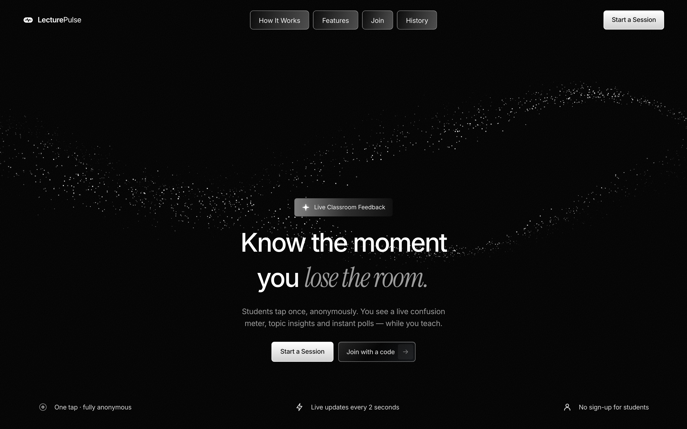
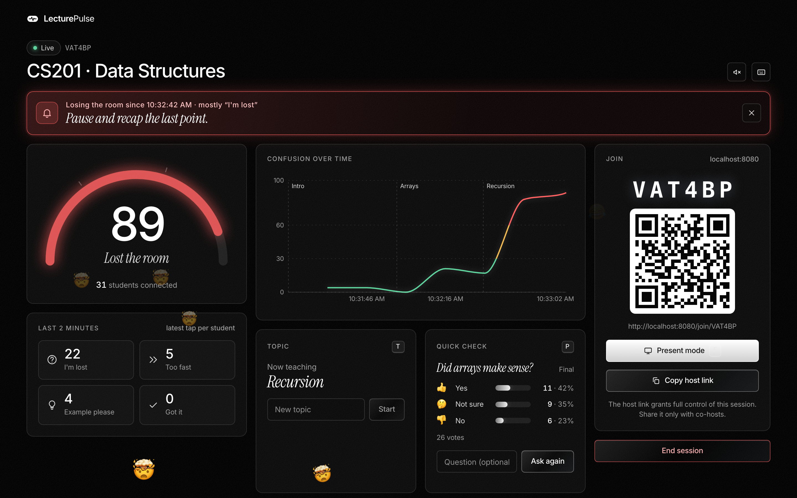
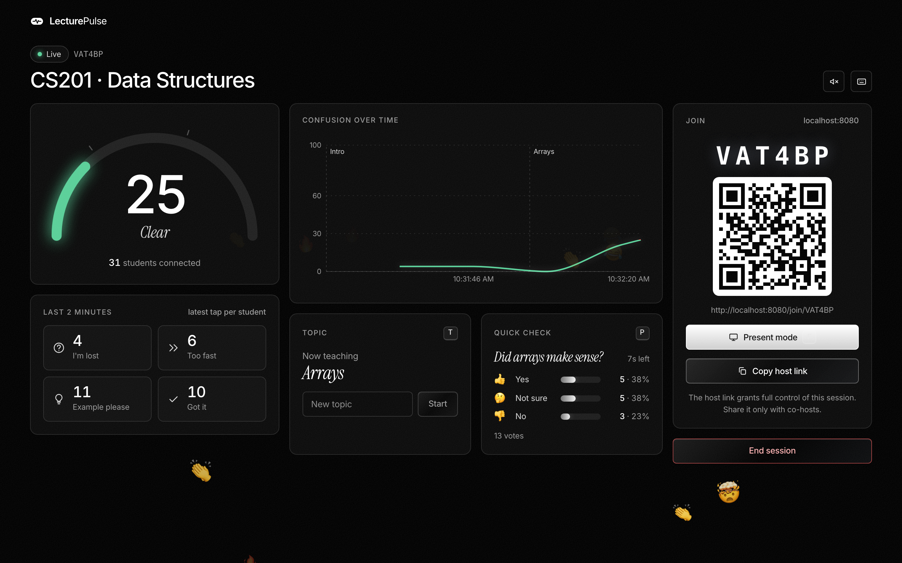
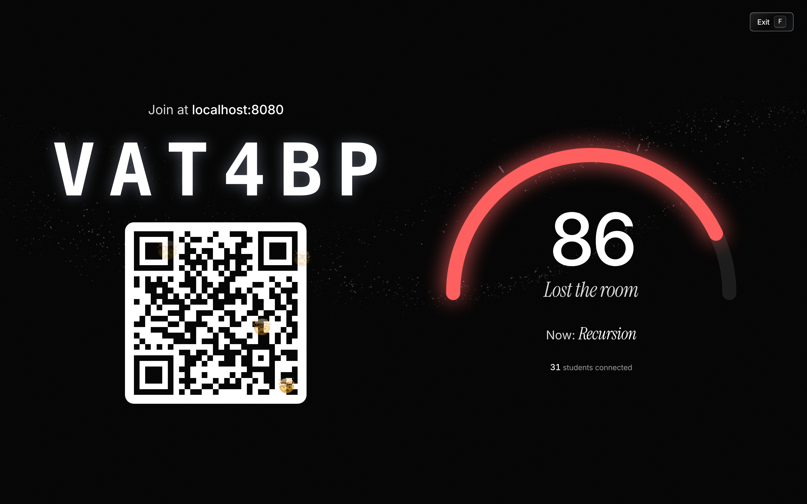
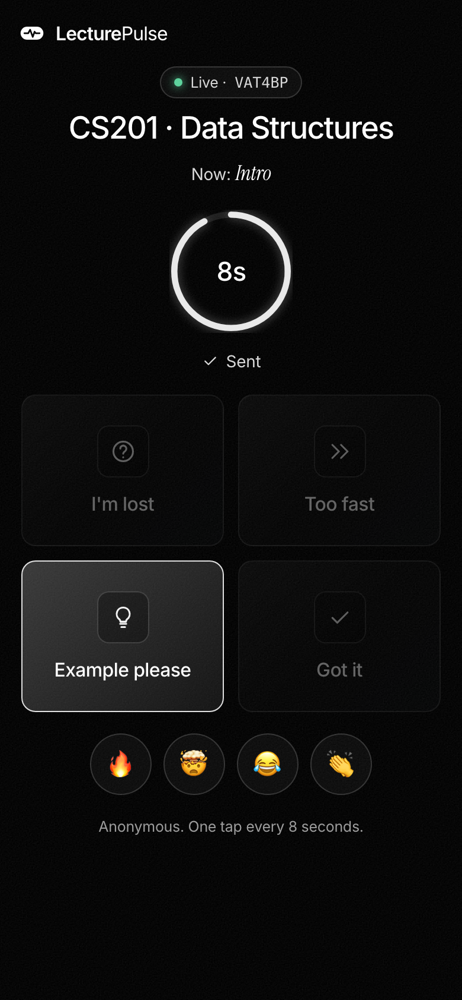
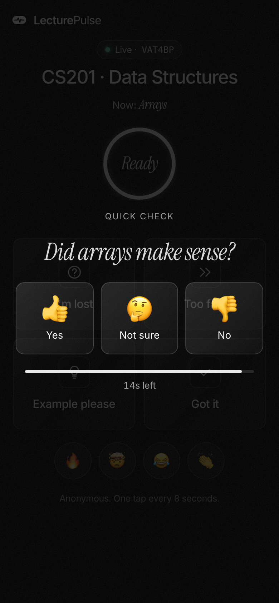
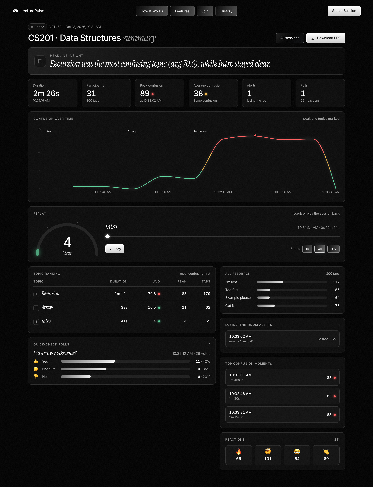
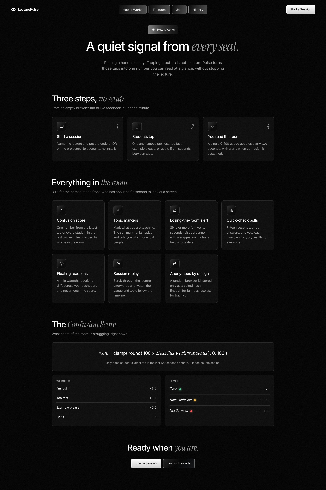
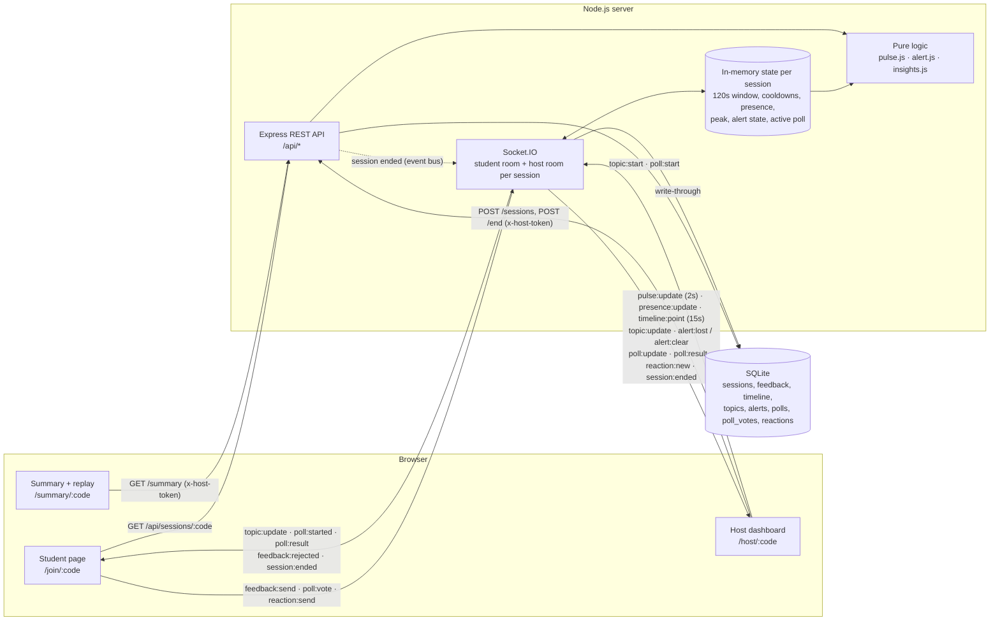

<div align="center">

# Lecture Pulse

**Anonymous, one-tap feedback from students and a live "confusion meter" for the lecturer,<br/>so you know the moment you lose the room.**

[](LICENSE)


[Quick Start](#quick-start) · [Features](#features) · [Architecture](#architecture) · [Confusion Score](#confusion-score) · [API Reference](#api-reference) · [Deployment](#deployment-on-render)



</div>

## Table of Contents

- **Overview**: [Problem Statement](#problem-statement) · [Objectives](#objectives) · [Features](#features)
- **Getting started**: [Quick Start](#quick-start) · [Development Guide](#development-guide) · [Troubleshooting](#troubleshooting)
- **How it works**: [Tech Stack](#tech-stack) · [Architecture](#architecture) · [Confusion Score](#confusion-score) · [Project Structure](#project-structure)
- **Reference**: [API Reference](#api-reference) · [Socket Events](#socket-events) · [Database Schema](#database-schema) · [Keyboard Shortcuts](#keyboard-shortcuts) · [Design System](#design-system)
- **Operations**: [Deployment on Render](#deployment-on-render)
- **Project notes**: [Design Decisions](#design-decisions) · [Challenges](#challenges) · [Known Limitations](#known-limitations) · [Roadmap](#roadmap)
- [Contributing](#contributing) · [License](#license)

## Problem Statement

In a lecture hall, the lecturer is flying blind. Students who are lost rarely raise a hand: it is socially costly, it interrupts the class, and nobody wants to be the only one. The lecturer finds out weeks later, in the exam results. Existing tools (polls, quizzes, Q&A boards) need the lecturer to stop and ask, and they need students to type.

Lecture Pulse gives every student a zero-friction, anonymous way to say *"I'm lost"*, *"too fast"*, *"example please"* or *"got it"* with a single tap, and turns those taps into one live number the lecturer can read at a glance while teaching.

## Objectives

1. Let students give feedback in **one tap, with no account and no identity**.
2. Give the lecturer **one glanceable signal** (0–100 score + level) that updates in real time, and **tell them** when it needs attention.
3. Make the signal **fair and hard to game**: one student cannot dominate it.
4. Connect confusion to **what was being taught**, so the review afterwards is actionable.
5. Be **deployable as a single small service** with no external infrastructure.

## Features

### For the lecturer



- **Live confusion gauge** (0–100) coloured by level, breathing faster as confusion rises, with live counts per feedback type and the number of students in the room.
- **Losing-the-room alert**: when the score stays at 60 or above for 20 seconds, a pulsing banner appears with a concrete suggestion ("Pause and recap the last point", "Slow down", "Try a concrete example"). Optional soft chime (off by default), dismissible.
- **Topic markers**: type what you are teaching now; topics appear as labelled markers on the timeline and students see the current topic.
- **Quick-check polls**: one key press asks "Did that make sense?" for 15 seconds, with animated live bars.
- **Floating reactions**: 🔥 🤯 😂 👏 from students drift across the dashboard.
- **Present mode**: full-screen code, QR and gauge for the projector.
- **Host link**: copy a link that opens the dashboard on another device or for a co-host.
- **Keyboard shortcuts** for everything you do mid-lecture.





### For students

<p>
  
  &nbsp;&nbsp;
  
</p>

- **No account, no install**: scan the QR or type a 6-character code.
- **Four large tap tiles**, a cooldown ring, a "Sent" confirmation and a haptic tick on supported phones.
- **Current topic** shown at the top, a **reaction row**, and a full-screen **poll overlay** with a countdown.
- Lightweight: the student route never downloads the chart, QR, particle or replay code.

### After the lecture



- **Headline insight**, for example *"Recursion was 3.1× more confusing than Arrays."*
- **Topic ranking**: duration, average score, peak and taps per topic, most confusing first.
- **Timeline** with the peak and topic markers, **top confusion moments** as clock times.
- **Alerts**, **poll results** and **reaction counts**.
- **Session replay**: play or scrub through the session at 1×/4×/16× and watch the gauge, level and topic follow.
- **Download PDF** through a dedicated print stylesheet.
- **History** of the sessions hosted in this browser.

### Under the hood

- **Anti-spam**: 8-second tap cooldown, 3-second reaction cooldown and one vote per poll, all enforced on the server per hashed client.
- **Privacy**: only a salted SHA-256 hash of a random browser id is stored; host tokens are stored hashed.
- **Resilience**: automatic reconnection with a banner, state rebuilt from the database after a restart, sessions auto-ended after 3 hours of inactivity.
- **Simulator** that plays a whole lecture (students and, optionally, the host) for demos.



## Quick Start

Requirements: **Node.js 20 or newer** and **npm 9+**.

```bash
git clone https://github.com/Abhinav2467/Lecture-Pulse.git
cd Lecture-Pulse
npm install
npm run dev
```

Then:

1. Open <http://localhost:5173> and choose **Start a session**.
2. Project the dashboard. Students scan the QR code or type the 6-character code on their phones.
3. Students tap; the gauge moves. End the session to see the summary and replay.

No students at hand? Fill the room with simulated ones:

```bash
npm run simulate -- <CODE>      # 30 students, 3 minutes
```

On macOS or Linux, `make` does the install, creates `.env` and starts everything in one step.

| Command | Make target | What it does |
| --- | --- | --- |
| `npm run dev` | `make` / `make dev` | API on `:4000` and Vite dev server on `:5173`, both with reload |
| `npm test` | `make test` | Runs the 100-test suite against an in-memory database |
| `npm run simulate -- <CODE>` | `make simulate CODE=<CODE>` | Simulated classroom for a running session |
| `npm run build` | `make build` | Builds the client into `client/dist` |
| `npm start` | `make start` | Production server: API and built client on one port |
| `npm run screenshots` | – | Regenerates the README screenshots with Playwright |
| – | `make prod` | Build, then start the production server |
| – | `make reset` | Deletes the local database (all sessions) |

## Tech Stack

| Technology | Purpose |
| --- | --- |
| Node.js 20+ (ES modules) | Server runtime |
| Express 5 | REST API and serving the built client in production |
| Socket.IO | Real-time feedback, pulse, topics, alerts, polls, reactions |
| better-sqlite3 (SQLite) | Persistent storage |
| nanoid | Session codes, ids and host tokens |
| helmet, cors, express-rate-limit | Security headers, CORS and abuse protection |
| dotenv, cross-env | Environment configuration; setting `NODE_ENV` portably in npm scripts |
| React 19 + Vite | Single-page client and dev server/bundler |
| React Router | Client-side routing with per-route code splitting |
| socket.io-client | Real-time client |
| Recharts | Timeline chart |
| qrcode.react | Join QR code |
| @fontsource-variable/inter, @fontsource/instrument-serif | Self-hosted fonts |
| Plain CSS with CSS variables | Design system (tokens in one file) |
| Vitest + Supertest | Unit, API and socket integration tests |
| Playwright (Chromium) | Automated README screenshots |
| concurrently, npm workspaces | Monorepo (`server`, `client`) and running both in development |

## Architecture



- **REST** handles everything request/response shaped: creating, looking up, ending and summarising sessions.
- **Socket.IO** handles everything live. Each session has a student room and a host room, so pulse, alerts and live poll bars only ever go to the host.
- **One 2-second loop** per server computes the pulse for every live session, tracks the peak and steps the alert state machine.
- **In-memory state** exists only while someone is connected to an active session; everything that matters is also written to SQLite and rebuilt from it on demand.
- **Pure logic** (`pulse.js`, `alert.js`, `insights.js`) has no I/O, which is what makes the score, the alert and the topic insight easy to unit-test.

## Confusion Score

The score answers one question: *right now, what share of the room is struggling?*

```
score = clamp( round( 100 × Σ weight(latest tap of each client in the last 120s) / max(activeStudents, 1) ), 0, 100 )
```

| Feedback | Weight | Meaning |
| --- | --- | --- |
| `LOST` | +1.0 | Completely lost |
| `TOO_FAST` | +0.7 | Following, but the pace is too high |
| `EXAMPLE` | +0.5 | Needs a concrete example |
| `GOT_IT` | −0.6 | Understands; pulls the score down |

| Score | Level | Colour |
| --- | --- | --- |
| 0–29 | Clear | `#5ad19a` |
| 30–59 | Some confusion | `#f2b84b` |
| 60–100 | Lost the room | `#ff5d5d` |

Rules that make it trustworthy:

- **Rolling window**: only taps from the last 120 seconds count, so the score decays on its own once the lecturer has clarified something.
- **Latest tap per client**: each student contributes exactly one vote, their most recent one. Tapping "Lost" ten times counts once, and tapping "Got it" afterwards replaces it.
- **Divided by students in the room**, not by voters: silence counts as "fine". `activeStudents` is the number of distinct clients connected, so extra tabs do not dilute the score.
- **Clamped** to 0–100: a happy room sits at 0 instead of going negative.

*Worked example*: 20 students connected. In the last two minutes 6 tapped `LOST`, 3 `TOO_FAST`, 2 `EXAMPLE` and 4 `GOT_IT`.
Sum = 6×1.0 + 3×0.7 + 2×0.5 − 4×0.6 = 6.7 → score = round(100 × 6.7 / 20) = **34 → "Some confusion"**.

### Alert hysteresis

A threshold alone would make the banner flicker whenever the score hovers around 60. The alert is a small state machine (`server/src/lib/alert.js`) stepped once per 2-second pulse:

```
            score ≥ 60 for 20s continuously
  idle ───────────────────────────────────────▶ ALERT   → emits alert:lost
   ▲      (any dip below 60 restarts the clock)   │
   │                                              │ stays active while score ≥ 45
   └──────────────────────────────────────────────┘
                    score < 45                      → emits alert:clear
```

- **Enter at 60, exit at 45.** The 15-point gap is the hysteresis: once raised, the alert survives the score wobbling between 45 and 59.
- **20 seconds, continuously.** A brief spike does nothing; one dip below 60 restarts the clock.
- **No re-alert without a clear.** While active, nothing else is emitted, however long it lasts.
- The **suggestion** follows the dominant kind of confusion at that moment (ties go to the more severe type): `LOST` → "Pause and recap the last point", `TOO_FAST` → "Slow down", `EXAMPLE` → "Try a concrete example".

### Topic insight

Each topic gets the average and peak of the timeline samples that fall inside it. The headline compares the most and least confusing topics, and is only produced when at least two topics have data. A ratio is only quoted when the denominator is meaningfully above zero: if the calmer topic averaged below 5, the sentence becomes *"Recursion was the most confusing topic (avg 67.6), while Arrays stayed clear."* instead of an absurd "45× more confusing"; ratios under 1.2 are reported as "similar".

## Project Structure

```
lecture-pulse/
├── package.json              # workspaces + root scripts
├── Makefile                  # make / make prod / make test / make simulate
├── render.yaml               # Render blueprint
├── .env.example
├── screenshots/              # generated by `npm run screenshots`
├── scripts/
│   ├── simulate.js           # fake classroom (students and, optionally, the host)
│   └── screenshots.js        # Playwright capture pipeline
├── server/
│   ├── src/
│   │   ├── index.js          # HTTP + Socket.IO bootstrap, auto-end job
│   │   ├── app.js            # Express app factory (importable by tests)
│   │   ├── config.js         # env loading
│   │   ├── db.js             # schema, migration, prepared statements
│   │   ├── sockets.js        # rooms, cooldowns, pulse loop, topics, alerts, polls, reactions
│   │   ├── routes/           # health.js, sessions.js
│   │   └── lib/
│   │       ├── pulse.js          # confusion score (pure)
│   │       ├── alert.js          # alert state machine with hysteresis (pure)
│   │       ├── insights.js       # topic stats, ranking, headline insight (pure)
│   │       ├── interactions.js   # constants + validators for topics, polls, reactions
│   │       ├── security.js       # hashing, code/token generation
│   │       └── sessionService.js # create/end/topics/summary, event bus
│   └── test/                 # pulse, alert, insights, api, socket, features, db, scripts
└── client/
    ├── index.html
    ├── vite.config.js        # dev proxy for /api and /socket.io
    └── src/
        ├── main.jsx, App.jsx # every page is a lazy chunk
        ├── pages/            # Home, About, Join, Host, Summary, History, NotFound
        ├── components/       # Gauge, TimelineChart, PollPanel, AlertBanner, ReplayPlayer, ...
        │   └── ui/           # Button, PillButton, Badge, Appear, Grain, Modal, Icon, Logo
        ├── hooks/            # useSessionSocket, useSessionInfo, useShareOrigin, useCooldown, useCountdown
        ├── lib/              # api, storage, format, constants, sound
        └── styles/           # theme.css (tokens), base, motion, ui + one file per page
```

## Development Guide

[Quick Start](#quick-start) covers installing and running. This section covers the rest of the workflow. Configuration is optional in development: every variable has a working default, and `cp .env.example .env` gives you a file to edit.

### Development

```bash
npm run dev                 # or: make
```

Starts the API on <http://localhost:4000> and the Vite dev server on <http://localhost:5173> (which proxies `/api` and `/socket.io`). Open the Vite URL.

### Testing with real phones

The dev server listens on every network interface, so any phone on the same Wi-Fi or hotspot can join. You do not need to find your IP address: when the dashboard is open on `localhost`, the QR code and join link automatically point at the machine's LAN address (for example `http://192.168.1.20:5173/join/ABC234`), and they follow the laptop if it changes network. If a phone cannot connect, see [Troubleshooting](#troubleshooting).

### Tests

```bash
npm test                    # or: make test
```

100 tests against an in-memory database: unit tests for the score, the alert state machine and the topic insight; API tests with Supertest; socket integration tests for feedback, presence, peak tracking, topics, alerts, polls and reactions; a schema-migration test; and a check that npm scripts stay cross-platform.

### Simulator

With the server running and a session created in the browser:

```bash
npm run simulate -- <CODE> [students=30] [minutes=3]
npm run simulate -- <CODE> 30 3 --host-actions --token <hostToken>
# or: make simulate CODE=<CODE>
```

Fake students join over the first few seconds and tap through four phases: Intro, Arrays, a sustained Recursion spike (long enough to trigger the alert) and a recap. They also send reactions and vote in any running poll.

With `--host-actions` the simulator also plays the lecturer: it starts the topics Intro → Arrays → Recursion and runs one poll. That needs the host token, which is the part after `#t=` in the dashboard's "Copy host link". Set `SERVER_URL` to point at a non-default server.

### Screenshots

```bash
npx playwright install chromium   # once; downloads the browser (not run automatically)
npm run screenshots               # add `-- --no-build` to reuse client/dist
```

Builds the client, starts the production server on a free port with a throw-away database, creates a session, runs the simulator with `--host-actions`, waits for the poll and the alert, and writes these files to `screenshots/` (about 3.5 minutes):

| File | View | Viewport |
| --- | --- | --- |
| `landing.png` | Landing page | 1440×900 |
| `about.png` | How it works (whole page) | 1440 wide |
| `student.png` | Student view after a tap | 390×844 |
| `student-poll.png` | Quick-check poll on the student's phone | 390×844 |
| `poll.png` | Dashboard during a quick-check poll | 1440×900 |
| `dashboard-live.png` | Dashboard with an active alert and reactions | 1440×900 |
| `present-mode.png` | Present mode | 1440×900 |
| `summary.png` | Session summary (whole page) | 1440 wide |

Sizes are CSS pixels; every image is captured at a device pixel ratio of 2.

### Production (locally)

```bash
npm run build     # builds client/dist
npm start         # NODE_ENV=production via cross-env; serves API + client on PORT (default 4000)
# or: make prod
```

### Environment variables

| Variable | Default | Description |
| --- | --- | --- |
| `PORT` | `4000` | HTTP port |
| `CLIENT_ORIGIN` | `http://localhost:5173` | Origin allowed by CORS (the dev client) |
| `DB_PATH` | `./data/pulse.db` | SQLite file, relative to the repo root; `:memory:` for tests |
| `SERVER_SALT` | insecure dev value | Secret mixed into client-id hashes. **Set this in production.** |
| `NODE_ENV` | `development` | `production` enables static serving and `trust proxy` |

### Optional hero video

Drop a file at `client/public/hero.mp4` and the landing page uses it as its background instead of the particle field. Nothing else needs to change.

## Troubleshooting

| Symptom | Cause and fix |
| --- | --- |
| A phone cannot open the join link | The phone and the laptop must be on the same network. Some phone hotspots and most campus or guest Wi-Fi networks isolate devices from each other; use a hotspot that allows it or an ordinary home router. The phone *providing* a hotspot often cannot reach devices connected to it, so test from a phone that is a client of the hotspot. |
| The QR code shows a `localhost` address | The server could not find a LAN address, which means the laptop is not connected to a network. Connect, then reload the dashboard. |
| The join link times out although both devices are on the same network | A firewall on the laptop is blocking the dev server. On macOS, allow incoming connections for `node` (System Settings → Network → Firewall → Options). |
| `EADDRINUSE` on start | Another process is using port 4000 or 5173. Stop it, or set `PORT` in `.env` for the API. |
| `better-sqlite3` fails to install | It downloads a prebuilt binary for your Node.js version and otherwise compiles from source. Use a current Node.js LTS release, delete `node_modules` and run `npm install` again. |
| "Host access only" on a dashboard or summary | Host access lives in the browser that created the session. Open the dashboard there, or use the link from **Copy host link**. |
| Sessions disappeared after a deploy | The free Render tier has no persistent disk; see [Deployment on Render](#deployment-on-render). |
| `npm run screenshots` cannot find a browser | Run `npx playwright install chromium` once. |

## API Reference

Base path `/api`. JSON in and out. Errors always have the shape `{ "error": "message" }`.

| Method | Path | Auth | Body | Success | Errors |
| --- | --- | --- | --- | --- | --- |
| `GET` | `/health` | – | – | `200 {ok:true}`; outside production also `lan`, the machine's LAN IPv4 address or `null` | – |
| `POST` | `/sessions` | – | `{title}` (1–80 chars) | `201 {code, hostToken, title}`; also opens the default topic "Intro" | `400` invalid title, `429` more than 10 per 15 min per IP |
| `GET` | `/sessions/:code` | – | – | `200 {code, title, active}` | `404` |
| `POST` | `/sessions/:code/end` | `x-host-token` | – | `200 {ok:true}` (idempotent); closes the open topic, alert and poll, emits `session:ended` | `401`, `404` |
| `GET` | `/sessions/:code/summary` | `x-host-token` | – | `200` summary (below) | `401`, `404` |

Summary response (abridged):

```json
{
  "code": "672FCB", "title": "CS201 · Data Structures", "active": false,
  "createdAt": 1791877064000, "endedAt": 1791877210000, "durationMs": 146000,
  "uniqueParticipants": 31,
  "totals": { "LOST": 106, "TOO_FAST": 57, "EXAMPLE": 49, "GOT_IT": 74 },
  "peakScore": 91, "peakAt": 1791877178000, "avgScore": 35,
  "timeline": [{ "ts": 1791877079000, "score": 8 }],
  "topConfusionMoments": [{ "ts": 1791877199000, "score": 84 }],
  "topics": [{ "id": 1, "label": "Intro", "startedAt": 1791877064000, "endedAt": 1791877105000, "durationMs": 41000, "avgScore": 4.5, "peakScore": 8, "taps": 54 }],
  "topicRanking": ["same objects as topics, most confusing first"],
  "topicInsight": "Recursion was the most confusing topic (avg 67.6), while Arrays stayed clear.",
  "alerts": [{ "startedAt": 1791877170000, "endedAt": 1791877206000, "dominantType": "LOST" }],
  "alertCount": 1,
  "polls": [{ "id": 1, "question": "Did arrays make sense?", "startedAt": 1791877120000, "closedAt": 1791877135000, "counts": { "YES": 12, "UNSURE": 7, "NO": 3 }, "total": 22 }],
  "reactions": { "🔥": 56, "🤯": 100, "😂": 50, "👏": 59 }
}
```

## Socket Events

Connect to the same origin with `auth` in the handshake:
students `{ role: 'student', code, clientId }`, hosts `{ role: 'host', code, hostToken }`.

| Event | Direction | Payload | Notes |
| --- | --- | --- | --- |
| `session:info` | server → both | `{code, title, active}` | Right after a successful join |
| `session:error` | server → both | `{message}` | Unknown session, bad role/client id, invalid host token; the server then disconnects |
| `session:ended` | server → both | `{code}` | Host ended the session, or it was auto-ended |
| `feedback:send` | student → server | `{type}` | `LOST`, `TOO_FAST`, `EXAMPLE` or `GOT_IT`. Ack `{ok:true, cooldownMs}` or `{ok:false, retryInMs}` / `{ok:false, error}` |
| `feedback:rejected` | server → student | `{retryInMs, reason}` | Tap inside the 8s cooldown (`cooldown`) or on an ended session (`ended`) |
| `pulse:update` | server → host | `{score, level, counts, activeStudents, ts}` | On connect, then every 2s |
| `presence:update` | server → host | `{activeStudents}` | A student connected or disconnected (distinct clients) |
| `timeline:init` | server → host | `[{ts, score}]` | Persisted timeline so far, on connect |
| `timeline:point` | server → host | `{ts, score}` | Every 15s |
| `topics:init` | server → host | `[{id, label, startedAt, endedAt}]` | All topics so far, on connect |
| `topic:start` | host → server | `{label}` (1–40 chars) | Closes the previous topic. Ack `{ok:true, topic}` or `{ok:false, error}`. Restarting the current topic is a no-op |
| `topic:update` | server → both | `{id, label, startedAt}` | New current topic; also sent to a student on connect |
| `alert:lost` | server → host | `{since, dominantType, suggestion}` | Score ≥ 60 for 20s. Re-sent to a host that connects while it is active |
| `alert:clear` | server → host | `{ts}` | Score dropped below 45 |
| `poll:start` | host → server | `{question?}` (≤ 120 chars) | Default "Did that make sense?". One at a time. Ack `{ok:true, poll}` or `{ok:false, error}` |
| `poll:started` | server → both | `{id, question, durationMs, remainingMs}` | Also sent to late joiners who have not voted |
| `poll:vote` | student → server | `{pollId, choice}` | `YES`, `UNSURE` or `NO`. One per client per poll. Ack `{ok:true}` or `{ok:false, error}` |
| `poll:update` | server → host | `{id, question, counts, total}` | After every vote (live bars) |
| `poll:result` | server → both | `{id, question, counts, total}` | When the poll closes after 15s |
| `reaction:send` | student → server | `{emoji}` | One of 🔥 🤯 😂 👏, one per 3s per client. Ack `{ok:true, cooldownMs}` or `{ok:false, retryInMs}` |
| `reaction:new` | server → host | `{emoji}` | Floats up on the dashboard |

## Database Schema

SQLite, created and migrated automatically on boot (`server/src/db.js`). All timestamps are Unix milliseconds.

| Table | Columns | Notes |
| --- | --- | --- |
| `sessions` | `id` PK, `code` UNIQUE, `title`, `host_token_hash`, `created_at`, `ended_at` NULL, `peak_score` NULL, `peak_at` NULL | Only the hash of the host token is stored. Peak columns were added by an `ALTER TABLE` migration |
| `feedback` | `id` PK, `session_id`, `type`, `client_hash`, `ts` | Index on `(session_id, ts)`. One row per accepted tap |
| `timeline` | `id` PK, `session_id`, `ts`, `score` | One sample every 15s, plus a final one when the session ends |
| `topics` | `id` PK, `session_id`, `label`, `started_at`, `ended_at` NULL | Exactly one open topic per active session; "Intro" is created with the session |
| `alerts` | `id` PK, `session_id`, `started_at`, `ended_at` NULL, `dominant_type` | One row per losing-the-room alert |
| `polls` | `id` PK, `session_id`, `question`, `started_at`, `closed_at` NULL | |
| `poll_votes` | `id` PK, `poll_id`, `client_hash`, `choice`, `ts`, **UNIQUE `(poll_id, client_hash)`** | The constraint is what enforces one vote per client |
| `reactions` | `session_id`, `emoji`, `count`, PK `(session_id, emoji)` | Aggregated counters, upserted |

## Keyboard Shortcuts

On the host dashboard. Ignored while typing in an input.

| Key | Action |
| --- | --- |
| `T` | Focus the new-topic input |
| `P` | Start a quick-check poll with the default question |
| `F` | Toggle present mode |
| `?` | Show the shortcut help |
| `Esc` | Close dialogs and present mode |

## Design System

The visual language is **inspired by a motionsites.ai template**: pure black, monochrome silver, liquid-glass controls and a staggered entrance. The brand, logo, copy and layout of the app pages are our own.

**Tokens** — every colour, size and spacing value is a CSS variable in `client/src/styles/theme.css`, including the responsive overrides for each breakpoint (≤560, ≤900, 901–1279, 1280–1599, ≥1600, ≥1920, ≥2560, and two short-height steps for the landing page).

| Group | Tokens |
| --- | --- |
| Surfaces | `--bg #000000`, `--card-bg rgba(255,255,255,0.04)`, `--border rgba(255,255,255,0.16)`, `--border-soft rgba(255,255,255,0.12)` |
| Text | `--text #ffffff`, `--stat #d8d8d8`, `--muted #9a9a9a` (7.4:1 on black) |
| Meaning | `--level-clear #5ad19a`, `--level-some #f2b84b`, `--level-lost #ff5d5d` |
| Scale | `--h1`, `--lede`, `--nav`, `--btn`, `--badge`, `--stat-size`, `--header-x/y`, `--stats-x/y`, `--hero-gap`, `--copy-max`, … |

**Colour discipline** — the interface is monochrome. Colour appears only as meaning: on the gauge arc, the alert banner, the segments of the chart line and small level dots. Reactions and poll answers are emoji, which bring their own.

**Typography** — Inter (variable) for all UI; Instrument Serif italic only for accent words (the headline's "lose the room.", the level name under the gauge, the current topic, the insight). Both are self-hosted through Fontsource; there is no runtime request to Google Fonts.

**Components** (`client/src/components/ui/`) — `Button` (solid silver / frosted ghost, with a shine sweep), `PillButton` (liquid-metal nav pill), `Badge` (gradient with sparkle), `Appear`, `Grain`, `Modal`, `Icon`, `Logo`. Cards are frosted: 4% white, 1px soft border, 16px backdrop blur, 12px radius.

**Motion** (`client/src/styles/motion.css`) — `<Appear variant delay>` adds `.appear` plus a modifier (`scale`, `soft`, `mask`, `pop`, `btn`, `side`, `stat`) and a `--d` stagger delay. Resting opacity is 1 and `animation-fill-mode: both` hides the element during its delay, so nothing is ever invisible if animations do not run. On `animationend` the element gets `.is-in`; a two-frame JS fallback does the same if no animation started. `prefers-reduced-motion` disables all transitions and animations, and the particle field draws one static frame.

**No white flash** — `index.html` paints black from an inline `<style>` and a `style` attribute on `<body>` before any stylesheet loads.

**Background** — the landing page uses `client/public/hero.mp4` if you add one (full-bleed, muted, looping); otherwise a 2D-canvas particle field (no WebGL) of two flowing ribbons, capped at 2,500 particles, DPR-aware and paused while the tab is hidden. A film-grain overlay (SVG `feTurbulence`) sits above everything at `z-index: 100`.

**Logo** — an original mark: a rounded capsule containing a single ECG pulse, also used as the white data-URI favicon.

## Deployment on Render

The repo contains a blueprint, `render.yaml`, for **one Web Service** that runs everything. In Render choose *New → Blueprint* and point it at the repository, or create a Web Service by hand with the same settings:

| Setting | Value |
| --- | --- |
| Runtime | Node |
| Build command | `npm install && npm run build` |
| Start command | `npm start` |
| Health check path | `/api/health` |

| Environment variable | Value |
| --- | --- |
| `NODE_VERSION` | `22` (20 or newer) |
| `NPM_CONFIG_INCLUDE` | `dev` (the client is built with Vite, a devDependency) |
| `SERVER_SALT` | a long random string (the blueprint generates one) |
| `CLIENT_ORIGIN` | your service URL, e.g. `https://lecture-pulse.onrender.com` |
| `DB_PATH` | `./data/pulse.db`, or a path on a persistent disk |

`PORT` is provided by Render and `npm start` sets `NODE_ENV=production`.

> **The free-tier disk is ephemeral.** The filesystem is wiped on every deploy and whenever the instance restarts or spins down after idling, so past sessions and summaries disappear. That is fine for a demo. For durable data, attach a Render persistent disk (paid) and point `DB_PATH` at it, or move to a hosted database. Free instances also sleep when idle, so the first request after a pause is slow.

## Design Decisions

- **No accounts.** Friction kills participation. The host is identified by a random 32-character token; only its SHA-256 hash is stored and it is compared with `crypto.timingSafeEqual`.
- **Host link in the URL fragment.** `/host/CODE#t=<token>` moves host access to another device. The token is in the fragment because browsers never send fragments to the server, so it stays out of access logs and `Referer` headers; the client stores it and strips it from the address bar and history immediately. Anyone holding the link controls the session, and the UI says so next to the button.
- **Anonymous by construction.** The server stores only `SHA-256(clientId + SERVER_SALT)`: enough for cooldowns, one-vote-per-poll and counting participants, useless for tracing a person.
- **`activeStudents` counts people, not connections**: distinct client hashes currently connected. Presence, the score denominator, the vote and every cooldown are keyed by the same id.
- **Live counts are de-duplicated** with the same "latest tap per client" rule as the score, so the numbers always explain the gauge. Summary totals count every accepted tap.
- **The peak is tracked on every pulse, not read off the chart.** It is stored in `peak_score` / `peak_at` when the session ends and when the room empties; the summary falls back to the timeline maximum for sessions without one. This is why the peak marker can sit above the chart line: the line is sampled every 15 seconds, the peak every 2.
- **Alert as a pure state machine**, stepped only by the 2-second loop so "20 seconds" is measured on a steady clock, with injectable timings for tests. An open alert is persisted, so a reloaded dashboard or a restarted server still shows it.
- **One vote per poll is a database constraint**, `UNIQUE (poll_id, client_hash)`, not an in-memory check: it holds across tabs, reconnects and races. Polls send the *remaining* time rather than an absolute end time, because student clocks are wrong more often than one would hope.
- **Polls and reactions never touch the score.** They have separate handlers, separate cooldowns and separate tables.
- **Topics are idempotent.** Starting the topic that is already current is a no-op, so a double click or a retry cannot split one topic into two. The default "Intro" topic is created in the same transaction as the session.
- **Insight wording is guarded.** No ratio is quoted against a near-zero average, and small differences are called similar.
- **Replay is client-side.** It interpolates the summary's timeline and topics; no extra endpoint, and it works offline once the summary has loaded. 1× is real time.
- **Memory for speed, SQLite for truth.** The rolling window, cooldowns and the active poll live in memory; everything else is written through and rebuilt on demand. In-memory state exists only while someone is connected.
- **Event bus between REST and sockets.** Ending a session emits on an internal `EventEmitter`; the socket layer listens. The Express app has no dependency on Socket.IO and is testable alone.
- **Schema changes are additive and automatic**: `CREATE TABLE IF NOT EXISTS` plus `ALTER TABLE ... ADD COLUMN` for missing nullable columns, on every boot.
- **Every page is its own chunk.** The student route loads React, the socket client and about 7 kB of page code; Recharts, the QR library, the particle canvas and the replay are only fetched on the pages that use them.
- **Colour only as meaning.** A monochrome interface makes the three level colours impossible to miss, which is the point of the product.
- **Grain as a tiled image.** The `feTurbulence` noise is rasterised once as a small repeating tile instead of filtering the whole viewport, so it costs nothing while the page animates.
- **`cross-env` for `NODE_ENV`**, as a runtime dependency of the server, so `npm start` works in Windows shells too.
- **Paths resolve from the repo root** for `.env` and `DB_PATH`, regardless of which workspace the process starts in.
- **Share links never say `localhost`.** In development the server reports its current LAN address and the dashboard uses it for the QR code, the join link and the host link whenever it is itself open on `localhost`. The address is read per request, so it stays right when the laptop moves to another network, and it is not exposed in production.

## Challenges

- **Making the score fair.** A naive count of "lost" taps is dominated by the most anxious student and never goes down. Counting only each client's latest tap inside a rolling window, with a negative weight for "got it", fixed both.
- **Choosing the denominator.** Dividing by voters makes two lost students in a silent room of fifty look like a disaster. Dividing by connected students treats silence as "fine", which matches how a lecturer reads a room.
- **Peak sampling.** The first version took the peak from the 15-second timeline, so a spike that rose and fell between two samples was invisible in the summary. The peak is now tracked separately on the 2-second pulse and flushed whenever the in-memory state is about to be dropped.
- **An alert that does not flap.** A single threshold made the banner flicker as the score hovered around 60. Two thresholds and a hold period fixed it; expressing it as a pure function of (state, score, time) made every edge case a one-line test.
- **Honest insights.** "Recursion was 45× more confusing than Arrays" is what you get by dividing by an average of 1.5. Deciding when *not* to print a ratio mattered more than computing it.
- **Stacking contexts.** The frosted cards use `backdrop-filter`, which makes them containing blocks for `position: fixed` children, and the fixed background layer first painted *over* the landing page footer. Dialogs are rendered outside cards, and the background sits at a negative z-index inside the page's own stacking context.
- **A gradient on a flat line.** The level-coloured chart line is an SVG gradient mapped onto the line's bounding box; a perfectly flat line has a box of zero height and simply disappears. Flat data falls back to a solid colour.
- **Deterministic screenshots of a live system.** The capture script waits for real conditions (a poll with votes, an alert banner, reactions on screen) rather than for fixed delays, and grows the viewport instead of stitching a full page so fixed layers cover the whole image.
- **Testing sockets and timers.** Intervals, the alert hold, poll duration and reaction cooldown are injectable, so integration tests run in milliseconds, and each test file gets its own in-memory database.
- **A QR code that pointed at the phone.** The join link was built from the page's own origin, so a dashboard opened on `localhost` handed phones a link to themselves. It only showed up when testing on a real hotspot, and is now handled by substituting the LAN address.

## Known Limitations

- **The host link is a bearer secret.** There is no way to revoke it short of ending the session, and without it (cleared site data, no link saved) host access is gone.
- **One person can still be several "students".** Distinct clients are distinct browser profiles; a second browser or a private window is a new client with its own vote and cooldowns. That is the price of having no accounts.
- **Topic statistics use the 15-second timeline.** A topic shorter than about 15 seconds may have no sample and shows "—"; the peak stat (2-second resolution) can be higher than any point on the chart or any topic peak.
- **Mid-session summaries can lag.** The stored peak is flushed when the session ends or the room empties; until then the summary uses the timeline maximum.
- **Replay interpolates** between 15-second samples, and 1× is real time, so long sessions are best watched at 16× or scrubbed.
- **A running poll does not survive a server restart**; it is dropped without a result broadcast. Votes already cast are kept.
- **Single instance only.** Live state is in process memory; several instances would need the Socket.IO Redis adapter and shared state.
- **SQLite on ephemeral hosting** (for example Render's free tier) is wiped on restart.
- **Rate limiting is per IP**, so many lecturers behind one campus NAT share the limit of 10 new sessions per 15 minutes.
- **The alert sound needs a click first.** Browsers block audio until the page has been interacted with; turning the toggle on is that interaction.
- **The UI is covered by the build and the screenshot run**, not by assertions; there are no browser-level end-to-end tests.
- **Emoji render with the system font**, so reactions and poll answers look different across platforms.

## Roadmap

- Free-text anonymous questions with upvoting.
- Revocable, expiring co-host links; optional host accounts.
- Higher-resolution timeline storage so topics and replay match the 2-second peak.
- Custom poll answers and a poll history panel on the dashboard.
- CSV export alongside the PDF.
- Horizontal scaling with the Socket.IO Redis adapter and PostgreSQL.
- Browser-level end-to-end tests with Playwright assertions.
- Localisation and a light theme for bright rooms.

## Contributing

Issues and pull requests are welcome. Before opening a pull request:

1. Run `npm test`; all tests must pass.
2. Keep the scoring, alert and insight logic in `server/src/lib/` free of I/O, and add a test for any change in behaviour.
3. Follow the existing commit style (`feat(server): …`, `fix(client): …`, `docs: …`).

## License

Released under the [MIT License](LICENSE).
