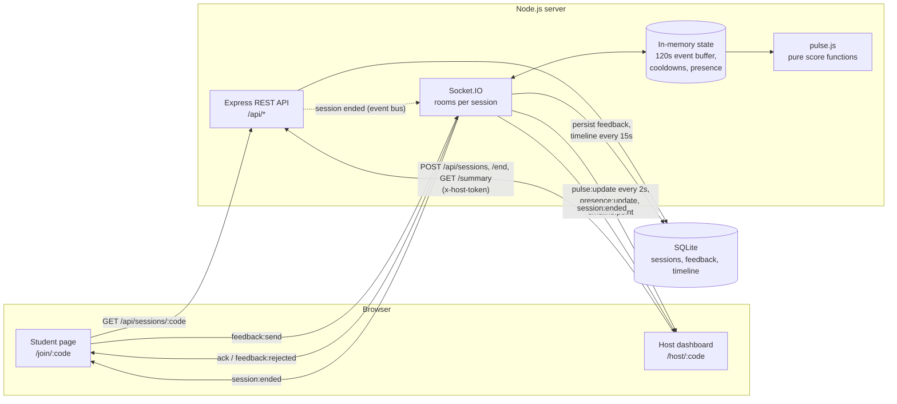

# Lecture Pulse

> Anonymous, one-tap feedback from students and a live "confusion meter" for the lecturer, so you know the moment you lose the room.

## Problem Statement

In a lecture hall, the lecturer is flying blind. Students who are lost rarely raise a hand: it is socially costly, it interrupts the class, and nobody wants to be the only one. The lecturer finds out weeks later, in the exam results. Existing tools (polls, quizzes, Q&A boards) need the lecturer to stop and ask, and they need students to type.

Lecture Pulse gives every student a zero-friction, anonymous way to say *"I'm lost"*, *"too fast"*, *"example please"* or *"got it"* with a single tap, and turns those taps into one live number the lecturer can read at a glance while teaching.

## Objectives

1. Let students give feedback in **one tap, with no account and no identity**.
2. Give the lecturer **one glanceable signal** (0–100 score + level) that updates in real time.
3. Make the signal **fair and hard to game**: one student cannot dominate it.
4. Keep a **timeline** so the lecturer can review afterwards which moments confused the class.
5. Be **deployable as a single small service** with no external infrastructure.

## Features

- **Sessions without accounts**: a lecturer starts a session and gets a 6-character code (no ambiguous `0/O/1/I`) plus a QR code.
- **Student view** (mobile-first): four large buttons, a circular cooldown ring, a "Sent ✓" confirmation and an ended state.
- **Host dashboard**: animated gauge coloured by level that "beats" faster as confusion rises, live counts per feedback type, connected-student count, and a live timeline chart.
- **Present mode**: enlarges the code and QR to full screen for the projector.
- **Session summary**: duration, participants, peak and average confusion, totals bar, timeline with peak markers, and the top confusion moments as clock times.
- **History**: the host's past sessions (stored in the browser), linking to their summaries.
- **Anti-spam**: 8-second per-client cooldown enforced on the server, latest-tap-only scoring, rate-limited session creation.
- **Privacy**: the server stores only a salted SHA-256 hash of a random browser id; host tokens are stored hashed.
- **Resilience**: "Reconnecting…" banner, automatic socket reconnection, state rebuilt from the database after a restart, sessions auto-ended after 3 hours of inactivity.
- **Simulator**: a script that fills a session with realistic fake students for demos and screenshots.

## Tech Stack

| Technology | Purpose |
| --- | --- |
| Node.js 20+ (ES modules) | Server runtime |
| Express 5 | REST API and serving the built client in production |
| Socket.IO | Real-time feedback, pulse updates and presence |
| better-sqlite3 (SQLite) | Persistent storage for sessions, feedback and the timeline |
| nanoid | Session codes, ids and host tokens |
| helmet, cors, express-rate-limit | Security headers, CORS and abuse protection |
| dotenv, cross-env | Environment configuration; setting `NODE_ENV` portably in npm scripts |
| React 19 + Vite | Single-page client and dev server/bundler |
| React Router | Client-side routing |
| socket.io-client | Real-time client |
| Recharts | Timeline line chart |
| qrcode.react | Join QR code |
| Plain CSS with CSS variables | Theming (all tokens in one file) |
| Vitest + Supertest | Unit, API and socket integration tests |
| concurrently | Running server and client together in development |
| npm workspaces | Monorepo (`server`, `client`) |

## Architecture



- **REST** handles everything request/response shaped: creating, looking up, ending and summarising sessions.
- **Socket.IO** handles everything live. Each session has a student room and a host room, so pulse data only ever goes to the host.
- **In-memory state** holds the rolling 120s window per session for fast scoring. Every accepted tap is also written to SQLite, and the window is rebuilt from SQLite when a session's state is first needed, so a restart loses nothing.
- **`pulse.js`** contains only pure functions, which is what makes the score easy to unit-test.

## Confusion Score

The score answers one question: *right now, what share of the room is struggling?*

```
score = clamp( round( 100 × Σ weight(latest tap of each client in the last 120s) / max(activeStudents, 1) ), 0, 100 )
```

| Feedback | Weight | Meaning |
| --- | --- | --- |
| `LOST` | +1.0 | Completely lost |
| `TOO_FAST` | +0.7 | Following, but the pace is too high |
| `EXAMPLE` | +0.5 | Needs a concrete example |
| `GOT_IT` | −0.6 | Understands; pulls the score down |

| Score | Level |
| --- | --- |
| 0–29 | Clear |
| 30–59 | Some confusion |
| 60–100 | Lost the room |

Rules that make it trustworthy:

- **Rolling window**: only taps from the last 120 seconds count, so the score decays on its own once the lecturer has clarified something.
- **Latest tap per client**: each student contributes exactly one vote, their most recent one. Tapping "Lost" ten times counts once, and tapping "Got it" afterwards replaces it.
- **Divided by connected students**, not by voters: silence counts as "fine". Three lost students in a room of sixty is a blip (score 5); three out of four is a problem (score 75).
- **Clamped** to 0–100: a happy room sits at 0 instead of going negative.

*Worked example*: 20 students connected. In the last two minutes 6 tapped `LOST`, 3 `TOO_FAST`, 2 `EXAMPLE` and 4 `GOT_IT`.
Sum = 6×1.0 + 3×0.7 + 2×0.5 − 4×0.6 = 6.7 → score = round(100 × 6.7 / 20) = **34 → "Some confusion"**.

The host receives a `pulse:update` every 2 seconds. Every 15 seconds the current score is appended to the persisted timeline that drives the chart and the summary.

## API Reference

Base path `/api`. JSON in and out. Errors always have the shape `{ "error": "message" }`.

| Method | Path | Auth | Body | Success | Errors |
| --- | --- | --- | --- | --- | --- |
| `GET` | `/health` | – | – | `200 {ok:true}` | – |
| `POST` | `/sessions` | – | `{title}` (1–80 chars) | `201 {code, hostToken, title}` | `400` invalid title, `429` more than 10 per 15 min per IP |
| `GET` | `/sessions/:code` | – | – | `200 {code, title, active}` | `404` |
| `POST` | `/sessions/:code/end` | `x-host-token` | – | `200 {ok:true}` (idempotent), emits `session:ended` | `401`, `404` |
| `GET` | `/sessions/:code/summary` | `x-host-token` | – | `200` summary (below) | `401`, `404` |

Summary response:

```json
{
  "code": "T8AZ62", "title": "CS201 · Recursion", "active": false,
  "createdAt": 1791820362940, "endedAt": 1791823962940, "durationMs": 3600000,
  "uniqueParticipants": 42,
  "totals": { "LOST": 31, "TOO_FAST": 18, "EXAMPLE": 22, "GOT_IT": 97 },
  "peakScore": 68, "peakAt": 1791821862940, "avgScore": 21,
  "timeline": [{ "ts": 1791820377940, "score": 4 }],
  "topConfusionMoments": [{ "ts": 1791821862940, "score": 68 }]
}
```

## Socket Events

Connect to the same origin with `auth` in the handshake:
students `{ role: 'student', code, clientId }`, hosts `{ role: 'host', code, hostToken }`.

| Event | Direction | Payload | Notes |
| --- | --- | --- | --- |
| `session:info` | server → both | `{code, title, active}` | Sent right after a successful join |
| `session:error` | server → both | `{message}` | Unknown session, bad role/client id, or invalid host token; the server then disconnects |
| `feedback:send` | student → server | `{type}` | `type` is `LOST`, `TOO_FAST`, `EXAMPLE` or `GOT_IT`. Ack: `{ok:true, cooldownMs}` or `{ok:false, retryInMs}` / `{ok:false, error}` |
| `feedback:rejected` | server → student | `{retryInMs, reason}` | Tap inside the 8s cooldown (`reason: 'cooldown'`) or on an ended session (`'ended'`) |
| `pulse:update` | server → host | `{score, level, counts:{LOST,TOO_FAST,EXAMPLE,GOT_IT}, activeStudents, ts}` | On connect, then every 2s while the session is active |
| `presence:update` | server → host | `{activeStudents}` | Whenever a student connects or disconnects |
| `timeline:init` | server → host | `[{ts, score}]` | Persisted timeline so far, on connect |
| `timeline:point` | server → host | `{ts, score}` | Every 15s |
| `session:ended` | server → both | `{code}` | Host ended the session, or it was auto-ended |

## Project Structure

```
lecture-pulse/
├── package.json              # workspaces + root scripts
├── .env.example
├── scripts/
│   └── simulate.js           # fake classroom for demos
├── server/
│   ├── src/
│   │   ├── index.js          # HTTP + Socket.IO bootstrap, auto-end job
│   │   ├── app.js            # Express app factory (importable by tests)
│   │   ├── config.js         # env loading
│   │   ├── db.js             # SQLite schema + prepared statements
│   │   ├── sockets.js        # rooms, cooldown, pulse/timeline broadcasting
│   │   ├── routes/
│   │   │   ├── health.js
│   │   │   └── sessions.js
│   │   └── lib/
│   │       ├── pulse.js          # confusion score (pure functions)
│   │       ├── security.js       # hashing, code/token generation
│   │       └── sessionService.js # create/end/summary, event bus
│   └── test/
│       ├── pulse.test.js
│       ├── api.test.js
│       └── socket.test.js
└── client/
    ├── index.html
    ├── vite.config.js        # dev proxy for /api and /socket.io
    └── src/
        ├── main.jsx, App.jsx
        ├── pages/            # Home, Join, Host, Summary, History, NotFound
        ├── components/       # Gauge, TimelineChart, JoinPanel, CooldownRing, ...
        ├── hooks/            # useSessionSocket, useSessionInfo, useCooldown
        ├── lib/              # api, storage, format, constants
        └── styles/           # theme.css (tokens), base.css, components.css
```

## Setup and Run

Requirements: Node.js 20 or newer and npm 9+.

```bash
npm install
cp .env.example .env        # optional in development; defaults work
```

### Development

```bash
npm run dev
```

Starts the API on <http://localhost:4000> and the Vite dev server on <http://localhost:5173> (which proxies `/api` and `/socket.io`). Open the Vite URL. The dev server also listens on your LAN address, so phones on the same Wi-Fi can scan the QR code if you open the dashboard through that address.

### Tests

```bash
npm test
```

Runs 60 tests against an in-memory database: unit tests for the score, API tests with Supertest, socket integration tests, a schema-migration test and a check that npm scripts stay cross-platform.

### Simulator

With the server running and a session created in the browser:

```bash
npm run simulate -- <CODE> [students=30] [minutes=3]
# e.g.
npm run simulate -- T8AZ62 40 4
```

Fake students join over the first few seconds and tap in three phases (warm-up, a confusion spike in the middle, recovery) while respecting the cooldown. Set `SERVER_URL` to point at a non-default server.

### Production (locally)

```bash
npm run build     # builds client/dist
npm start         # NODE_ENV=production (via cross-env, so it also works on Windows); serves API + client on PORT (default 4000)
```

### Environment variables

| Variable | Default | Description |
| --- | --- | --- |
| `PORT` | `4000` | HTTP port |
| `CLIENT_ORIGIN` | `http://localhost:5173` | Origin allowed by CORS (the dev client) |
| `DB_PATH` | `./data/pulse.db` | SQLite file, relative to the repo root; `:memory:` for tests |
| `SERVER_SALT` | insecure dev value | Secret mixed into client-id hashes. **Set this in production.** |
| `NODE_ENV` | `development` | `production` enables static serving and `trust proxy` |

## Deployment on Render

One **Web Service** runs everything.

| Setting | Value |
| --- | --- |
| Runtime | Node |
| Build command | `npm install && npm run build` |
| Start command | `npm start` |
| Health check path | `/api/health` |

Environment variables:

| Key | Value |
| --- | --- |
| `NODE_VERSION` | `20` (or newer) |
| `SERVER_SALT` | a long random string |
| `CLIENT_ORIGIN` | your service URL, e.g. `https://lecture-pulse.onrender.com` |
| `DB_PATH` | `./data/pulse.db` (or a path on a persistent disk) |

`PORT` is provided by Render, and `npm start` sets `NODE_ENV=production`.

> **SQLite on the free tier is ephemeral.** The filesystem is wiped on every deploy and whenever the instance restarts or spins down after idling, so past sessions and summaries disappear. This is fine for a demo. For durable data, attach a Render persistent disk (paid) and point `DB_PATH` at it, or move to a hosted database.

Also note that free instances sleep when idle, so the first request after a pause takes a while to respond.

## Screenshots

Create a session, run the simulator, and capture:

| View | Path |
| --- | --- |
| Home | `docs/screenshots/home.png` |
| Student view (mobile) | `docs/screenshots/student.png` |
| Student cooldown | `docs/screenshots/student-cooldown.png` |
| Host dashboard | `docs/screenshots/host-dashboard.png` |
| Present mode | `docs/screenshots/present-mode.png` |
| Summary | `docs/screenshots/summary.png` |
| History | `docs/screenshots/history.png` |


## Design Decisions

- **No accounts.** Friction kills participation. The host is identified by a random 32-character token kept in `localStorage`; only its SHA-256 hash is stored and it is compared with `crypto.timingSafeEqual`. The trade-off is that the dashboard and summary are tied to the browser that created the session.
- **Anonymous by construction.** The browser generates a random id; the server stores only `SHA-256(clientId + SERVER_SALT)`. It is enough to enforce the cooldown and count unique participants, and it cannot be traced back to a person.
- **Participants = students who tapped.** Students who only watched leave no trace in the database, so `uniqueParticipants` counts distinct clients with at least one tap.
- **Live counts are de-duplicated.** The `counts` in `pulse:update` use the same "latest tap per client in the window" rule as the score, so the numbers on the dashboard always explain the gauge. Summary `totals` count every accepted tap.
- **`activeStudents` counts people, not connections.** It is the number of distinct client hashes currently connected as students, so a student with two tabs (or a phone and a laptop tab in the same browser profile) is one student. Presence, the score denominator, the vote and the cooldown are all keyed by the same hashed client id, which keeps the numerator and denominator of the score in the same unit.
- **The peak is tracked on every pulse, not read off the chart.** The server computes the pulse every 2s for every live session (whether or not a host is watching) and remembers the highest score and when it happened. It is written to nullable `peak_score` / `peak_at` columns on the session row when the session ends, and also when the room empties, so it survives the in-memory state being dropped. The summary uses the stored peak, and falls back to the timeline maximum for sessions that have none (or in the unlikely case the timeline is higher). The write can only raise the stored value.
- **Schema changes are additive and automatic.** `migrate()` runs on every boot: `CREATE TABLE IF NOT EXISTS` for new databases, and `ALTER TABLE ... ADD COLUMN` for any missing nullable column on existing ones. No migration tool, no data loss, safe to re-run.
- **`cross-env` for `NODE_ENV`.** `npm start` works in Windows cmd and PowerShell as well as POSIX shells. It is a runtime dependency of the server because production installs skip dev dependencies. A test fails if any root or server script sets an environment variable without it.
- **Cooldown keyed by client hash, not socket**, so reconnecting or opening tabs does not bypass it. The client-side ring is cosmetic and re-syncs from the server's `retryInMs`.
- **Memory for speed, SQLite for truth.** The 120s window lives in memory; every tap is also persisted and the window is rehydrated from the database on demand. In-memory state exists only while someone is connected to an active session and is dropped as soon as the session ends.
- **Event bus between REST and sockets.** Ending a session (via the API or the auto-end job) emits on an internal `EventEmitter`; the socket layer listens. The Express app therefore has no dependency on Socket.IO and is testable alone.
- **Two extra socket events** (`timeline:init`, `timeline:point`) beyond the spec, so the host chart survives a page reload. The chart also shows a trailing "now" point from the latest pulse so the line moves between 15s samples.
- **A final timeline point is written when a session ends** (if anyone is connected), so very short sessions still have a chart.
- **"Top confusion moments"** are the three highest timeline points with a score above 0; a zero is not a confusion moment.
- **Auto-end** uses "last feedback, or creation time if none" as the activity timestamp, checked at boot and every 10 minutes.
- **Paths resolve from the repo root.** `.env` and `DB_PATH` are resolved relative to the repository root regardless of which workspace the process starts in.
- **Invalid or missing host token returns `401`** for both cases, without revealing which.
- **Host pages are code-split.** Recharts and the QR library load only on `/host` and `/summary`, so students on mobile data download a much smaller bundle.
- **Theming via CSS variables only.** Every colour, font and spacing value is in `client/src/styles/theme.css`; charts and the gauge read the same variables.
- **`uuid` fallback.** `crypto.randomUUID` only exists in secure contexts; students joining over plain HTTP on a LAN address fall back to `crypto.getRandomValues`.
- **better-sqlite3 was used as planned** (v13 ships prebuilt binaries, so no native compile was needed); the `sql.js` fallback was not required.

## Challenges

- **Making the score fair.** A naive count of "lost" taps is dominated by the most anxious student and never goes down. Counting only each client's latest tap inside a rolling window, with a negative weight for "got it", fixed both.
- **Choosing the denominator.** Dividing by voters makes two lost students in a silent room of fifty look like a disaster. Dividing by connected students treats silence as "fine", which matches how a lecturer reads a room.
- **Server-authoritative cooldown.** The cooldown had to hold across reconnects, multiple tabs and server restarts, which is why it is keyed by the hashed client id and rebuilt from persisted feedback.
- **Real-time state versus persistence.** Scoring from SQLite on every tick would be wasteful; keeping everything in memory would lose data on restart. The hybrid (in-memory window, write-through persistence, lazy rehydration) needed careful clean-up rules.
- **Testing sockets and timers.** Broadcast intervals are injectable (`attachSockets(io, { pulseIntervalMs })`) so the integration test runs in milliseconds, and each test file gets its own in-memory database.
- **Peak sampling.** The first version took the peak from the timeline, which is sampled every 15 seconds. A spike that rose and fell between two samples (a student joining can halve the score in one tick) was simply invisible in the summary, and the reported peak could be lower than a number the lecturer had just watched on the gauge. Sampling the timeline faster would have bloated the table and the chart, so the peak is now tracked separately from the 2-second pulse computation and stored as two columns. The remaining subtlety was lifetime: in-memory state is dropped when the last socket leaves, so the peak has to be flushed at that moment too, and re-read when the state is rebuilt.
- **Ordering of "emit then disconnect".** Rejected connections must receive `session:error` before the socket closes, so the server uses a graceful `disconnect()` after emitting instead of rejecting in middleware.

## Known Limitations

- **Host access is per browser.** The host token lives in `localStorage`; the dashboard and summary cannot be opened from another device, and clearing site data loses access.
- **One person can still be several "students".** Distinct clients are distinct browser profiles. A second browser, a private window or cleared storage produces a new client id, with its own vote and cooldown. That is the price of having no accounts.
- **Peak resolution is 2 seconds, and the chart can disagree with it.** The peak is exact to the pulse interval, but the timeline is still sampled every 15 seconds, so the peak stat may be higher than any point on the chart, and "top confusion moments" (taken from the timeline) may not include the peak instant.
- **Mid-session summaries can lag.** The stored peak is flushed when the session ends or the room empties. A summary opened while the session is still running uses the timeline maximum until then.
- **Sessions that ended before this change** have no stored peak and use the timeline maximum.
- **Average confusion** is the mean of the 15-second samples, not of every pulse.
- **Single instance only.** Live state (window, cooldowns, presence, peak) is in process memory; running several instances would need the Socket.IO Redis adapter and shared state.
- **SQLite on ephemeral hosting** (for example Render's free tier) is wiped on restart.
- **Rate limiting is per IP**, so many lecturers behind one campus NAT share the limit of 10 new sessions per 15 minutes.
- **No browser-level end-to-end tests** yet; the UI is covered only by the build.
- **Screenshots** in this README are placeholder paths.

## Future Work

- Free-text anonymous questions with upvoting.
- Slide/topic markers so confusion moments map to content, not just clock times.
- Export of the summary as CSV/PDF.
- Optional host accounts so dashboards and history follow the lecturer across devices.
- Horizontal scaling with the Socket.IO Redis adapter and a shared database (PostgreSQL).
- Smarter "top moments" (merge neighbouring peaks into intervals).
- Sound or haptic alert for the host when the level crosses into "Lost the room".
- Browser-level end-to-end tests (Playwright) and light/dark theme switching.

## License

[MIT](LICENSE)
